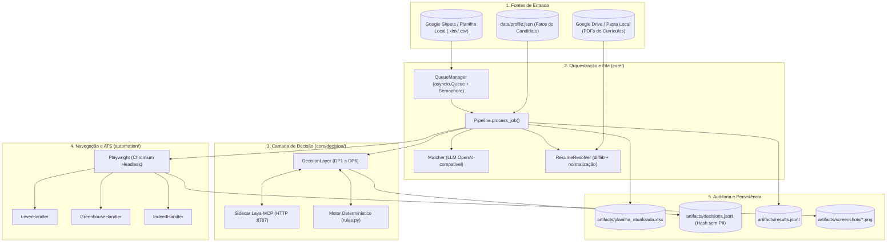
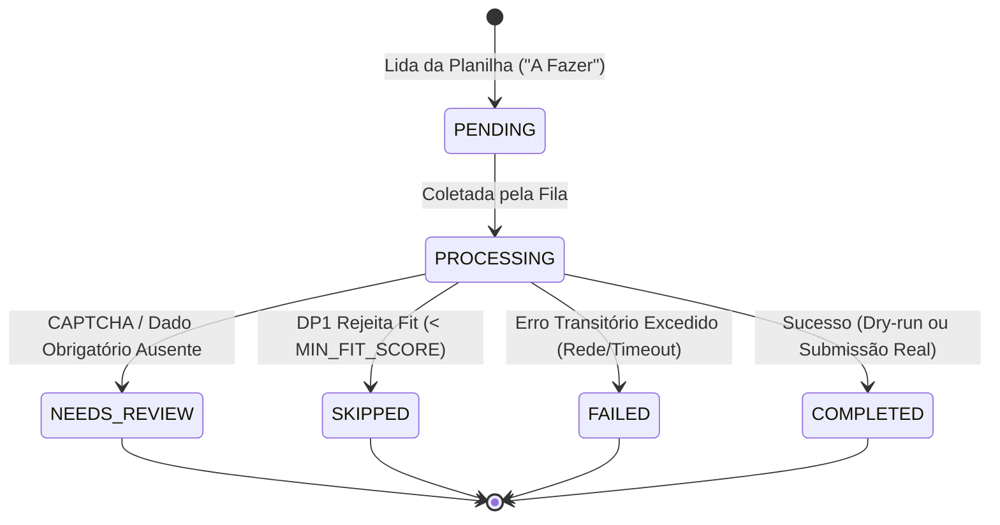

# Arquitetura do Sistema e Fluxo do Pipeline

O sistema **Candidata IA** (`job-harness`) opera como um orquestrador em lote com execução assíncrona orientada a eventos e I/O não bloqueante em Python 3.11+.

---

## 1. Topologia de Componentes

---

## 2. Subsistemas e Responsabilidades

### 2.1 Ponto de Entrada (`main.py`)
- Parse de argumentos de linha de comando (`--limit`, `--source-csv`, `--no-dry-run`, `--backend`, `--ats`, `--concurrency`).
- Inicialização segura do ambiente (`config.settings.Settings`).
- Pré-voo de verificação de dependências (Playwright browsers, conectividade com storage e warm-up do Laya).

### 2.2 Orquestrador e Fila (`core/pipeline.py` & `core/queue_manager.py`)
- Gerencia o ciclo de vida assíncrono de cada vaga.
- Concorrência limitada por semáforo (`MAX_CONCURRENCY`, padrão 3).
- **Invariante Pós-Submit**: Erros ocorridos após o clique em submissão nunca sofrem retentativa (`PostSubmitError`), evitando envios em duplicidade.

### 2.3 Camada de Decisão (`core/decision/`)
- Módulos [decision_engine.md](decision_engine.md).
- Isola o julgamento lógico da execução:
  - **DP1**: Fit da vaga com o perfil (`job_fit`).
  - **DP2**: Seleção de currículo quando não especificado (`resume_fallback`).
  - **DP3**: Detecção de bloqueadores/CAPTCHA (`blocker_check`).
  - **DP4**: Detecção de sensibilidade/EEO (`question_sensitivity`).
  - **DP5**: Mapeamento determinístico de campos (`field_mapping`).
  - **DP6**: Verificação final pré-envio (`ready_to_submit`).

### 2.4 Automação de Navegador (`automation/`)
- Classes baseadas em `BaseATSHandler` utilizando Playwright.
- Ciclo de 3 fases por formulário:
  1. `inspect(page)`: Coleta formulário, campos visíveis e possíveis bloqueadores.
  2. `fill(page, answers, resume_path)`: Preenchimento simulado ou real de inputs e upload de arquivos (`set_input_files`).
  3. `submit(page, dry_run)`: Verificação prévia e submissão real apenas quando `dry_run=False`.
- Bloqueio ativo de scripts terceiros de analytics e trackers (`BLOCKED_URL_PATTERNS`) para velocidade e privacidade.

### 2.5 Camada de Armazenamento (`storage/`)
- `sheet_loader.py`: Carrega vagas preservando cabeçalhos e IDs estáveis baseados em hash de `Empresa + Cargo`.
- `sheet_writer.py`: **Princípio da Imutabilidade**: A planilha original de entrada nunca é modificada. Toda saída é gravada em cópia independente (`artifacts/planilha_atualizada.xlsx`).
- `drive_client.py`: Sincronização sob demanda de currículos em PDF do Google Drive para cache local com autenticação OAuth ou Service Account.

### 2.6 Camada de Interface Visual e Painel Web (`web/`)
- `web/app.py`: Servidor FastAPI com endpoints REST e stream de Server-Sent Events (SSE).
- `web/runner.py`: Orquestrador assíncrono em background gerenciando a fila, broadcast de eventos de granularidade fina (`on_step`, `on_progress`) e cancelamento gracioso.
- `web/config_manager.py`: Leitura e gravação sanitizada de credenciais no `.env` e validação ativa de chaves LLM.
- `web/cookie_manager.py`: Inspeção, importação e gravação de cookies e inicialização de login visual interativo.
- `web/static/`: Single-Page Application (SPA) em HTML5/CSS3/JavaScript puro para consumo imediato sem compilação.
- `iniciar_painel.bat` e `web/__main__.py`: Inicializadores de 1 clique para usuários finais.
- Mais detalhes em [ui_specification.md](ui_specification.md).

---

## 3. Estados de Execução de uma Vaga

Para detalhes sobre como as decisões de transição de estado são tomadas, consulte o documento [Motor de Decisão Calibrada](decision_engine.md).
