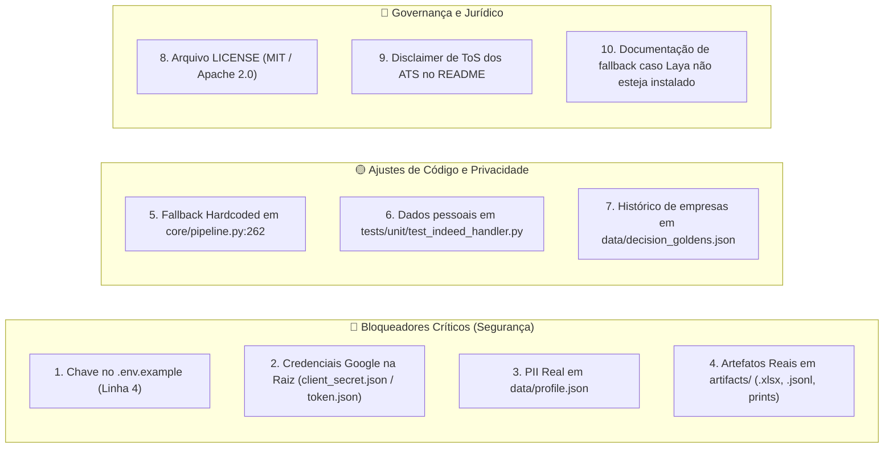

# Diagnóstico e Estratégia de Abertura Open Source

Este documento detalha o plano estratégico e a auditoria de segurança necessária para transformar o **Candidata IA** em um repositório público de código aberto de alto impacto.

---

## 1. Avaliação de Potencial de Impacto

Projetos de automação de candidaturas costumam atrair milhares de desenvolvedores no GitHub. No entanto, a imensa maioria sofre de:
1. Scripts frágeis baseados em timeouts cegos;
2. Ausência de testes automatizados;
3. Spam indiscriminado que viola ética e queima a imagem dos candidatos.

O **Candidata IA** tem potencial para ser uma referência no ecossistema por aliar **automação robusta com guardrails éticos, testes formais (99+ testes) e calibração estatística**.

---

## 2. Inventário de Bloqueadores e Riscos (Auditoria Pré-Publicação)

Como o repositório **ainda não possui Git inicializado**, o histórico de commits está limpo. Os seguintes itens críticos devem ser saneados antes do primeiro `git init`:



### Detalhamento dos Itens de Ação

#### 🔴 1. Chave de API no `.env.example`
- **Diagnóstico**: A linha 4 de `.env.example` continha uma chave de API real (`LLM_API_KEY=...`).
- **Ação**: Substituir imediatamente por `LLM_API_KEY=sua_chave_aqui`.

#### 🔴 2. Credenciais Google na Raiz
- **Diagnóstico**: `client_secret.json` e `token.json` concedem acesso direto a serviços do Google Cloud e Google Drive.
- **Ação**: Garantir que ambos estão no `.gitignore` e conferir com `git status` antes de qualquer commit.

#### 🔴 3. Dados Pessoais (PII) em `data/profile.json`
- **Diagnóstico**: Arquivo com e-mail, telefone, pretensão salarial e respostas de autodeclaração.
- **Ação**: Manter no repositório exclusivamente o `data/profile.example.json` (que já está devidamente anonimizado com "Fulana de Tal").

#### 🔴 4. Planilhas e Logs Reais em `artifacts/`
- **Diagnóstico**: A pasta contém dezenas de cópias de planilhas (`planilha_atualizada_*.xlsx`), prints de vagas aplicadas e o histórico `decisions.jsonl`.
- **Ação**: Ignorar completamente a pasta `artifacts/` no `.gitignore`, mantendo apenas um arquivo `.gitkeep` vazio se necessário.

#### 🟡 5. Fallback Pessoal em `core/pipeline.py`
- **Diagnóstico**: Na linha 262, o código possui o fallback fixo:
  ```python
  return (profile.links.get("linkedin") or "https://linkedin.com/in/rauan-bernardo") + " (Video intro available upon request)"
  ```
- **Ação**: Substituir por:
  ```python
  linkedin_url = profile.links.get("linkedin", "")
  return (f"{linkedin_url} (Video intro available upon request)").strip()
  ```

#### 🟡 6. Dados em Testes Unitários
- **Diagnóstico**: `tests/unit/test_indeed_handler.py` (linhas 43-47) cita o nome e e-mail real do autor.
- **Ação**: Substituir por `"Jane Doe"` e `"jane.doe@example.com"`.

---

## 3. Estratégia de Licenciamento

Recomendação de licença para o projeto:

| Opção | Características | Recomendação |
| :--- | :--- | :--- |
| **MIT License** | Máxima permissividade, amplamente adotada pela comunidade Python/IA, atrai maior número de contribuidores e adoção. | ⭐ **Altamente Recomendada** |
| **Apache 2.0** | Permissiva como o MIT, mas inclui concessão explícita de patentes e proteção de marcas registradas. | ⭐ **Excelente Alternativa Corporativa** |
| **AGPL v3** | Copyleft forte; obriga qualquer pessoa que modifique e rode o software como serviço na rede a abrir o código. | Não recomendada se o objetivo for ampla tração e adoção voluntária. |

---

## 4. Roteiro de Execução de Lançamento

1. **Higienização e Anonimização**:
   - Ajustar `.env.example`, `core/pipeline.py` e testes unitários.
   - Atualizar `.gitignore` rigoroso.
2. **Documentação e Governança**:
   - Adicionar arquivo `LICENSE` (MIT ou Apache 2.0).
   - Inserir seção de Disclaimer Legal no `README.md`.
   - Adicionar `CONTRIBUTING.md` com instruções de testes (`pytest -q`).
3. **Inicialização do Repositório**:
   - Executar `git init`.
   - Executar `git status` para validar que nenhum arquivo sensível foi estagiado.
   - Criar commit inicial de lançamento: `feat: initial open-source release with ethical guardrails`.
4. **Publicação no GitHub**:
   - Criar repositório público com tags pertinentes (`playwright`, `ai-agent`, `job-automation`, `python`, `open-knowledge-format`).
