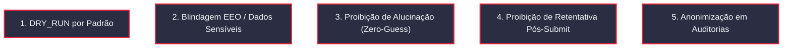

# Políticas de Segurança, Ética e Privacidade

O **Candidata IA** foi concebido com uma premissa fundamental: automação de candidaturas só é viável se for estritamente **ética, defensiva e respeitosa aos dados do candidato e às plataformas**.

---

## 1. As 5 Invariantes Invioláveis de Execução

Estas 5 regras são aplicadas em tempo de compilação/execução e protegidas por testes unitários contínuos em `tests/unit/`:

### Invariante 1: Dry-Run por Padrão Seguro
- Por padrão, `DRY_RUN=True`.
- O navegador preenche todos os campos, carrega o currículo e tira screenshot de auditoria em `artifacts/screenshots/`, mas **nunca clica no botão final de submissão** a menos que o usuário execute explicitamente com `--no-dry-run`.

### Invariante 2: Blindagem EEO e Dados Protegidos
- Perguntas sobre autodeclaração étnico-racial, identidade de gênero, orientação sexual, deficiência (PCD) ou condição de veterano **NUNCA são enviadas para modelos de linguagem (LLM) nem para o sidecar Laya**.
- O motor intercepta tais campos deterministicamente via regex em `_SENSITIVE_PATTERNS` e consulta exclusivamente as preferências declaradas pelo próprio candidato em `profile.eeo` (ex.: *"Decline to self-identify"*).

### Invariante 3: Proibição de Alucinação (Zero-Guess)
- O modelo de linguagem atua como um preenchedor restrito aos fatos: ele **não tem permissão para inventar qualificações, experiências ou números**.
- Se um campo obrigatório do formulário exigir um fato inexistente no perfil do candidato (ex.: *"Possui certificação AWS DevOps Pro?"*), a resposta é mapeada como `null` e a vaga transiciona imediatamente para o estado `NEEDS_REVIEW`. Nenhuma resposta falsa é submetida.

### Invariante 4: Proibição de Retentativa Pós-Submit
- Retentativas em lote com backoff exponencial são permitidas apenas para falhas transitórias pré-envio (timeouts de navegação, carregamento de página lenta).
- Qualquer erro que ocorra **após o evento de clique no botão de submissão** levanta `PostSubmitError` e encerra a vaga sem retentativa. Isso impede envios duplicados no ATS da empresa.

### Invariante 5: Auditoria sem PII (Privacy by Design)
- O log de decisões auditadas (`artifacts/decisions.jsonl`) registra o hash criptográfico `state_sha256` das entradas em vez de salvar o texto aberto ou os dados pessoais do candidato.

---

## 2. Conformidade com Termos de Uso (ToS) e ATSs

Plataformas de ATS (Greenhouse, Lever) e portais corporativos possuem termos de serviço que restringem uso de bots ou sobrecarga de infraestrutura. O sistema adota medidas preventivas:

| Risco de Plataforma | Mecanismo de Defesa do Candidata IA |
| :--- | :--- |
| **Sobrecarga de Servidor (DDoS acidental)** | Concorrência estritamente limitada via semáforo assíncrono (`MAX_CONCURRENCY`, padrão 3) e atraso adaptativo entre requisições. |
| **Detecção de Automação e Bloqueio de IP** | Headers realistas de navegador via Playwright Chromium, delays humanos entre preenchimento e clique. |
| **Desperdício de Banda e Tracking** | Bloqueio de scripts de analytics terceiros (`google-analytics.com`, `hotjar.com`, `segment.io`) via `route.abort()`. |
| **Desafio de Segurança (CAPTCHA / Turnstile)** | O sistema **não tenta quebrar CAPTCHAs**. Ao detectar um desafio de segurança, a vaga é abortada imediatamente com status `NEEDS_REVIEW`. |

---

## 3. Aviso Legal de Responsabilidade (Disclaimer Obrigatório)

> [!WARNING]
> Este software foi concebido como uma ferramenta de assistência à produtividade pessoal e pesquisa em agentes autônomos.  
> O usuário assume total e exclusiva responsabilidade por:
> 1. Garantir que as informações submetidas aos formulários representam com fidedignidade suas reais qualificações profissionais;
> 2. Revisar as candidaturas geradas e manter auditoria de seus envios;
> 3. Cumprir integralmente os Termos de Serviço vigentes em cada plataforma de contratação.
