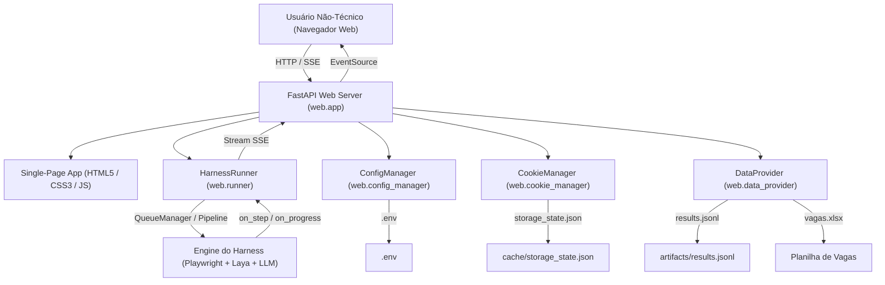

# Candidata IA — Especificação da Interface Visual (UI) e Painel Não-Técnico

> **Padrão de Especificação**: Open Knowledge Format (Google Cloud, v0.2)  
> **Módulo**: `web/` (`web.app`, `web.runner`, `web.config_manager`, `web.cookie_manager`, `web.data_provider`)  
> **Objetivo**: Permitir que usuários leigos e não-técnicos operem, acompanhem e configurem o harness de candidaturas com 100% de autonomia, sem necessidade de IDE, terminal ou manipulação manual de arquivos de código.

---

## 1. Visão Geral e Filosofia de Design

A interface foi concebida sob os princípios do design de sistemas modernos (estética Linear/Vercel), priorizando:
1. **Zero Atrito Técnico**: Inicialização com 1 clique através de `iniciar_painel.bat` ou `python -m web`, abrindo automaticamente o navegador em `http://127.0.0.1:8000`.
2. **Transparência Total (Auditabilidade em Tempo Real)**: Visibilidade exata do que os navegadores estão executando a cada segundo (etapa atual, empresa, cargo, timer e progresso).
3. **Métricas Claras e Tangíveis**:
   - Qual currículo PDF específico foi anexado em cada vaga.
   - Quanto tempo a IA demorou em cada processamento.
   - Quantos tokens de IA (Gemini/OpenAI) foram consumidos (prompt vs resposta).
   - Vagas que deram erro ou necessitam de revisão humana, com visualização em modal da tela capturada pelo robô.
4. **Configuração Amigável**: Formulários para cadastrar chaves de API com botão de teste de conexão em tempo real e gerenciador visual de cookies de contas (Indeed, Gupy, LinkedIn).

---

## 2. Arquitetura da Camada Web

---

## 3. Módulos e Funcionalidades da Interface

### 3.1. Visão Geral & Ao Vivo (Dashboard)
- **HUD de Progresso em Tempo Real**:
  - Barra de progresso com porcentagem dinâmica calculada via Server-Sent Events.
  - Indicador de vagas concluídas, restantes e total na fila.
  - Cartão de atividade dos navegadores mostrando a etapa em execução instantânea:
    - *Iniciando triagem da vaga*
    - *Resolvendo currículo compatível*
    - *Acessando página da vaga*
    - *Inspecionando formulário e campos*
    - *Sintetizando respostas com IA*
    - *Preenchendo campos no formulário*
    - *Candidatura concluída*
- **Grade de KPIs de Desempenho**:
  - **Currículos Enviados**: Total de candidaturas enviadas de fato vs simulações (dry-run).
  - **Tempo da IA**: Duração acumulada e média em segundos por vaga.
  - **Tokens Gastos**: Total de tokens consumidos com detalhamento de entrada (prompt) e saída (resposta).
  - **Revisão Humana Necessária**: Contagem de vagas pausadas por CAPTCHA, blocker ou dado sensível.
  - **Falhas / Erros**: Contagem de falhas técnicas.
  - **Tooltips Explicativos `(?)`**: Cada card de KPI possui explicação em linguagem acessível para operadores leigos.
- **Terminal de Logs Amigável & Barra de Ferramentas**:
  - Console visual com timestamp e categorização de mensagens (INFO, WARNING, ERROR).
  - Ferramentas integradas: **Copiar Logs** (para suporte/diagnóstico), **Limpar Console**, **Auto-Scroll** (pausar/retomar rolagem) e **Filtro de Severidade** (apenas avisos e erros).

### 3.2. Candidaturas & Histórico de Vagas
- **Tabela Interativa e Ordenável**: Clique nos cabeçalhos para ordenar por Empresa, Status, Currículo, Duração ou Tokens.
- **Pesquisa Instantânea com Limpeza em 1 Clique**: Campo de busca com botão de limpar (X) e atalho de teclado `/`.
- **Filtros com Contadores Dinâmicos**: Badges numéricas atualizadas em tempo real (*Todas (N)*, *Concluídas (N)*, *Revisão (N)*, *Erros (N)*, *Descartadas (N)*).
- **Exportação para CSV/Excel**: Botão de exportação instantânea em formato UTF-8 com BOM para abertura perfeita no Excel.
- **Gaveta / Modal de Auditoria Detalhada**: Ao clicar na linha da vaga, abre visualizador com todos os detalhes: link direto, currículo exato, tokens de prompt vs. completion, tempos de início/término e motivo sem truncamento.
- **Botão "Ver Evidência"**: Abre um visualizador modal com a captura de tela salva onde o robô interrompeu o preenchimento para inspeção humana, com botões para baixar ou abrir em nova aba.

### 3.3. Configurações & Gestão de Credenciais
- **Chaves de API & Presets de Modelos**:
  - Mascaramento de segurança com botão de alternar visibilidade.
  - Menu suspenso de **Presets Rápidos** (`Gemini 2.5 Flash`, `Gemini 1.5 Pro`, `GPT-4o-mini`, `GPT-4o`) preenchendo automaticamente nomes e URLs base.
  - Botão **"Testar Conexão"**: Realiza uma requisição real para a API do Gemini/OpenAI e exibe feedback imediato de latência (ms) e sucesso.
  - Indicador visual de **Alterações Pendentes** quando algum campo é modificado.
- **Cookies & Contas**:
  - Visualização de contas conectadas (*Indeed*, *Gupy*, *LinkedIn*).
  - Modal com botões diretos de 1 clique para login visual em cada plataforma (*Indeed Brasil*, *Gupy*, *LinkedIn* ou URL customizada).
  - Botão **"Importar / Colar Cookies JSON"**: Modal para colar exportações de cookies em formato Playwright ou de extensões de navegador (*EditThisCookie*).
  - Botão **"Limpar Sessão Salva"**: Remove os cookies antigos do disco.
- **Planilha e Currículos**:
  - Edição do link do Google Sheets com botão direto para abrir a planilha em nova aba.
- **Regras de Execução**:
  - Alternador de Modo Simulação (Dry-Run: seguro).
  - Alternador de Modo Autônomo (não para por perguntas triviais).
  - Concorrência de navegadores (1 a 10).
  - Motor Camoufox (anti-detect) vs Chromium padrão.
  - Botão **"Gravar Configurações no Arquivo .env"** que persiste sem reiniciar o servidor.

### 3.4. Galeria de Evidências (Screenshots)
- Contador dinâmico de capturas no badge da barra de navegação superior.
- Galeria em grade de miniaturas com todas as telas capturadas.
- Lightbox de alta resolução com botões de download e abertura em nova aba.

### 3.5. Feedback Sensorial e Acessibilidade por Teclado
- **Alerta Sonoro Opcional**: Toque sutil de 2 notas sintetizado nativamente via Web Audio API ao concluir execuções ou solicitar revisão humana (com interruptor no cabeçalho).
- **Atalhos Globais de Teclado**:
  - `Esc`: Fecha qualquer modal ativo.
  - `/`: Foca diretamente na barra de busca de candidaturas.
  - `1` a `5`: Alterna rapidamente entre as 5 abas da aplicação.

---

## 4. Endpoints da API REST e Stream SSE

| Método | Endpoint | Descrição |
| :--- | :--- | :--- |
| `GET` | `/` | Serve a aplicação SPA estática (`index.html`). |
| `GET` | `/api/status` | Retorna o snapshot do estado do runner (`is_running`, `total_jobs`, etc.). |
| `GET` | `/api/events` | Stream SSE de baixa latência para transmissão de eventos ao vivo. |
| `POST` | `/api/run` | Dispara execução em segundo plano com parâmetros personalizados. |
| `POST` | `/api/stop` | Interrompe a execução ativa com desligamento seguro. |
| `GET` | `/api/jobs` | Lista de vagas da planilha central. |
| `GET` | `/api/results` | Histórico consolidado de candidaturas com métricas. |
| `GET` | `/api/metrics` | Consolidação de KPIs (tokens, tempo, contagens). |
| `GET` | `/api/config` | Configurações atuais sanitizadas do `.env`. |
| `POST` | `/api/config` | Gravação segura de alterações no `.env`. |
| `POST` | `/api/config/test-llm` | Teste de conectividade e validação da chave de API. |
| `GET` | `/api/cookies` | Status e domínios do `storage_state.json`. |
| `POST` | `/api/cookies` | Importação de cookies JSON. |
| `DELETE` | `/api/cookies` | Limpeza de sessão de cookies. |
| `POST` | `/api/cookies/launch-login` | Abertura de navegador visível para autenticação interativa. |
| `GET` | `/api/screenshots/{filename}` | Download/visualização segura de capturas de tela. |

---

## 5. Instruções para o Usuário Final (Sem Código)

1. **Como Iniciar o Painel**:
   - Dê um duplo clique no arquivo `iniciar_painel.bat` na raiz da pasta.
   - O navegador abrirá automaticamente em alguns segundos.
2. **Como Configurar sua Chave de API**:
   - Acesse a aba **Configurações**.
   - Cole sua chave gratuita do Google AI Studio no campo correspondente.
   - Clique em **Testar Conexão** para certificar que está funcionando.
   - Clique em **Salvar Todas as Configurações**.
3. **Como Fazer Login nas Contas (Indeed/Gupy)**:
   - Na aba **Configurações**, na seção de Cookies, clique em **Abrir Navegador para Fazer Login**.
   - Faça login na sua conta normalmente na janela que abrir.
   - Seus cookies serão guardados e a IA usará sua conta logada automaticamente.
4. **Como Executar as Candidaturas**:
   - No topo da página, clique no botão azul **▶ Iniciar Automação**.
   - Escolha se deseja testar em modo simulação (sem enviar) ou em modo real.
   - Acompanhe na aba **Visão Geral & Ao Vivo** exatamente o que cada navegador está preenchendo!
