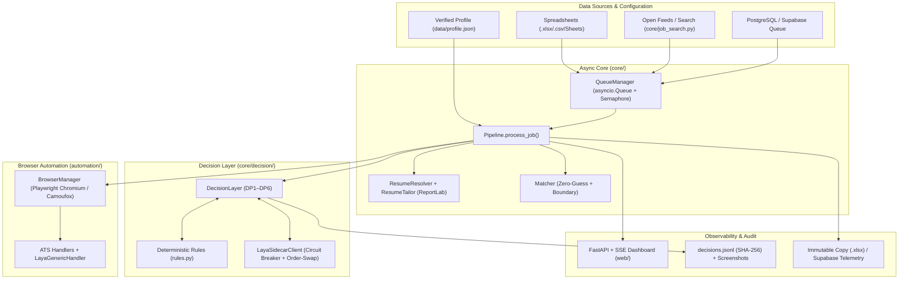

# Job Application Harness (`ia_candidata`)

<p align="left">
  🇺🇸 <strong>English</strong> &nbsp;|&nbsp; 🇧🇷 <a href="README.md"><strong>Ler em Português (README.md)</strong></a>
</p>

An asynchronous **Python 3.11+** engineering harness for **resilient browser orchestration, calibrated statistical decision gating, and fact-grounded LLM form automation**, applied to Applicant Tracking Systems (**Greenhouse, Lever, Workable, Indeed**, and compatible adapters).

Built as an applied systems engineering project focused on four real-world challenges of production web agents: **bounded concurrency and post-submit idempotency**, **calibrated hybrid decision-making (deterministic rules + statistical ML gating)**, **anti-hallucination & prompt-injection defenses**, and **real-time SSE observability**.

---

## 🧠 Engineering & Architectural Highlights

### 1. Hybrid Calibrated Decision Engine (`core/decision/`)
Rather than delegating critical control flow to unconstrained LLM prompts, execution branches are decomposed into **6 typed Decision Points (`DP1`–`DP6`)**:

| Decision Point | Responsibility | Protocol Type | Deterministic Fallback |
| :--- | :--- | :--- | :--- |
| **`DP1`** (`job_fit`) | Role-to-profile technical alignment | `noul` (Yes/No) | Minimum fit threshold (`MIN_FIT_SCORE`) |
| **`DP2`** (`resume_fallback`) | Base resume selection | `choice` | Language heuristic + structured LLM |
| **`DP3`** (`blocker_check`) | CAPTCHA / login / 404 detection | `noul` (Yes/No) | Deterministic regex on `page_signals` |
| **`DP4`** (`question_sensitivity`) | EEO / protected attribute isolation | `noul` (Yes/No) | `_SENSITIVE_PATTERNS` deterministic filter |
| **`DP5`** (`field_mapping`) | Semantic form-label mapping | `choice` | Normalized synonym table |
| **`DP6`** (`ready_to_submit`) | Pre-submission readiness check | `noul` (Yes/No) | Required DOM field verification |

- **Out-of-Process Neural Sidecar (`core/decision/laya_client.py`)**: Async `httpx` client with `/plan` preflight checks, CPU latency timeout scaling, **positional-bias mitigation via order-swap** on multi-choice queries, and a **half-open circuit breaker** (`LAYA_MAX_FAILURES`, `LAYA_BREAKER_COOLDOWN_S`).
- **Statistical Calibration Gate (ECE)**: [`scripts/eval_decisions.py`](scripts/eval_decisions.py) computes Expected Calibration Error (ECE), selective accuracy, and abstention coverage against [`data/decision_goldens.json`](data/decision_goldens.json). Missing or expired evaluation reports (`LAYA_EVAL_MAX_AGE_DAYS=14`) automatically demote releasing DPs back to `shadow` mode.

### 2. Safety, Idempotency & Anti-Hallucination Invariants
- **Asymmetric Safety Gate**: Probabilistic models in `DP3`, `DP4`, and `DP6` can **never** override a deterministic safety block.
- **Zero-Guess Grounding (`core/matcher.py`, `core/resume_tailor.py`)**: Required form questions lacking verifiable facts in `data/profile.json` resolve to `null` and transition the item to `NEEDS_REVIEW` instead of fabricating answers.
- **Prompt-Injection Boundaries & PII Isolation**: Untrusted job text is encapsulated in `<job>` tags; protected demographic attributes (`profile.eeo`) never reach external LLMs; decision audit logs (`artifacts/decisions.jsonl`) record cryptographic `state_sha256` hashes instead of raw PII.
- **Post-Submit Idempotency (`core/queue_manager.py`)**: Transient pre-submit failures retry with exponential backoff (respecting `Retry-After`), whereas any error after clicking submit raises `PostSubmitError` and permanently blocks retries to prevent duplicate submissions.
- **Safe Default (`DRY_RUN=true`)**: Populates the entire form and captures screenshot evidence without clicking submit unless `--no-dry-run` is explicitly supplied.

### 3. Bounded Async Pipeline, Transactional Cloud Queue & Atomic Budget Quota
- **Bounded Execution (`core/pipeline.py`, `core/queue_manager.py`)**: `asyncio.Queue` + `Semaphore(MAX_CONCURRENCY)`, per-task deadlines (`TASK_TIMEOUT_S`), `AsyncExitStack` resource cleanup, and graceful `CancelledError` handling preserving partial outputs.
- **Cloud Worker & Edge Quota Proxy (`cloud_worker.py`, `supabase/`)**: Containerized worker daemon ([`Dockerfile`](Dockerfile), [`docker-compose.yml`](docker-compose.yml), [`deploy_vps.sh`](deploy_vps.sh)) consuming jobs safely via PostgreSQL RPC `worker_claim_next_job` (`FOR UPDATE SKIP LOCKED`), paired with a Deno Edge Function ([`supabase/functions/llm-proxy/index.ts`](supabase/functions/llm-proxy/index.ts)) and atomic SQL quota ledger ([`0006_llm_proxy_budget_quota.sql`](supabase/migrations/0006_llm_proxy_budget_quota.sql)).

### 4. Polymorphic ATS Adapters, Semantic DOM Navigator & SSE Telemetry
- **Adapter Registry (`automation/registry.py`)**: `BaseATSHandler` shared lifecycle with ATS-specific adapters (`greenhouse.py`, `lever.py`, `workable.py`, `indeed.py`, `gupy.py`, `linkedin.py`, `aggregator.py`), Playwright route interception to block third-party trackers, and a generic semantic DOM navigator ([`automation/laya_navigator.py`](automation/laya_navigator.py)) with an offline sandbox ([`automation/laya_demo.py`](automation/laya_demo.py)).
- **Local Observability Panel (`web/`)**: FastAPI + Server-Sent Events (`/api/events`) dashboard with real-time step/token/latency telemetry, API secret masking, path-traversal protection, localhost-restricted CORS, and ATS-friendly PDF resume compilation via **ReportLab** ([`core/resume_pdf.py`](core/resume_pdf.py)).

---

## 🏗️ System Topology



---

## 📁 Repository Layout

```text
ia_candidata/
├── main.py                  # Primary async batch CLI (spreadsheets, live search, or Supabase queue)
├── cloud_worker.py          # Continuous production worker backed by Supabase RPC queue
├── automation/              # BrowserManager (Chromium/Camoufox), ATS handlers & LayaGenericHandler
├── core/                    # Pipeline, QueueManager, Matcher, ResumeTailor/PDF & DP1–DP6 engine
├── config/                  # Typed Pydantic Settings (.env)
├── storage/                 # Immutable Google Sheets/Drive & Supabase clients
├── supabase/                # Atomic quota SQL migration & Edge Function llm-proxy
├── web/                     # Local FastAPI + SSE dashboard, secret masking & cookie manager
├── scripts/                 # Google OAuth helper, login_browser, eval_decisions.py (ECE) & Task Scheduler
├── data/                    # Example profile (profile.example.json) & golden eval set (decision_goldens.json)
├── docs/                    # Technical architecture docs & ADRs (docs/okf/)
└── tests/                   # Offline unit suite (220+ tests) & local aiohttp/Playwright integration suite
```

---

## 🚀 Installation & Local Setup

### Prerequisites
- **Python 3.11+**
- **Git**

### Setup

```bash
# 1. Clone and create a virtual environment
git clone https://github.com/Rauan2014/job-application-harness.git
cd job-application-harness
python -m venv .venv

# Windows (PowerShell):
.\.venv\Scripts\Activate.ps1
# Linux / macOS:
source .venv/bin/activate

# 2. Install dependencies
pip install -r requirements.txt
pip install -r requirements-dev.txt

# Optional — Laya neural decision sidecar:
pip install -r requirements-laya.txt

# 3. Install browser binaries
playwright install chromium
python -m camoufox fetch

# 4. Copy environment and profile templates
cp .env.example .env
cp data/profile.example.json data/profile.json
```

> **Offline execution tip:** Set `DRIVE_FOLDER_ID=none` in `.env` and store PDFs in `cache/resumes/` to run without Google Drive. Add `--backend rules --no-llm` for 100% deterministic local execution without external LLM calls.

---

## 🖥️ Usage Modes

### 1. Local Web Telemetry Panel (`web/`)
```bash
python -m web
# Windows: iniciar_painel.bat | Linux/macOS: ./iniciar_painel.sh
```
Open `http://127.0.0.1:8000` to inspect the live SSE stream (`/api/events`), run the offline **Laya Web Navigator Sandbox**, manage configuration with masked secrets, and review execution screenshots and token usage.

### 2. Command-Line Interface (`main.py`)
```bash
# Safe dry-run simulation (default — fills forms and saves screenshots without submitting)
python main.py --sheet tests/fixtures/vagas_sample.csv --limit 3

# 100% deterministic local mode (zero external LLM or sidecar calls)
python main.py --sheet tests/fixtures/vagas_sample.csv --limit 3 --backend rules --no-llm

# Open-feed search + immediate dry-run execution
python main.py --search "Python Backend" --limit 5

# Strict Human-in-the-Loop pause on missing required profile facts
python main.py --limit 3 --no-autonomous

# Live ATS submission (explicitly disables dry-run)
python main.py --limit 3 --no-dry-run

# Process pending jobs directly from Supabase
python main.py --from-supabase --limit 10
```

<details>
<summary>CLI Flags Reference</summary>

| Flag | Description | Default |
| :--- | :--- | :--- |
| `--sheet PATH_OR_URL` | Local `.xlsx`/`.csv` path or Google Sheets URL/ID | `GOOGLE_SHEET_URL` or `data/vagas.xlsx` |
| `--search QUERY` | Searches configured feeds and enqueues results | Disabled |
| `--from-supabase` | Loads pending jobs from `job_applications` | `False` |
| `--profile PATH` | Path to candidate profile JSON | `data/profile.json` |
| `--limit N` | Maximum number of jobs in this run | Unlimited |
| `--dry-run` / `--no-dry-run` | Safe simulation vs. live submission | `--dry-run` (`True`) |
| `--concurrency N` | Max concurrent browser sessions | `MAX_CONCURRENCY` (`3`) |
| `--backend {laya,rules}` | Decision engine (`laya` or deterministic `rules`) | `DECISION_BACKEND` (`laya`) |
| `--browser {camoufox,chromium}` | Browser engine | `USE_CAMOUFOX` (`camoufox`) |
| `--no-llm` | Disables external LLM calls | `False` |
| `--autonomous` / `--no-autonomous` | Synthesize optional fields vs. strict review pause | `AUTONOMOUS_MODE` |
| `--sync-drive` | Sync PDF resumes from Google Drive before running | `False` |

</details>

### 3. Scheduled Feed Sync & Containerized Worker
```bash
# One-shot or scheduled open-feed sync (core/daily_job_hunter.py)
python -m core.daily_job_hunter --run-now

# Docker worker deployment (uses .env.worker.example as template)
cp .env.worker.example .env
docker compose up -d --build
```

---

## 🧪 Testing, Static Checks & Statistical Evaluation

The unit test suite runs **100% offline** (`respx` HTTP mocks + isolated fixtures), and the integration suite spins up local `aiohttp` mock ATS servers to exercise real Playwright DOM flows without external network dependencies:

```bash
# Fast offline unit tests
pytest tests/unit -q

# Local Playwright + aiohttp integration tests
pytest tests/integration -m "integration and not laya_live" -q

# Lint (Ruff) and static type checks (Mypy)
ruff check .
mypy core config automation storage web main.py cloud_worker.py

# Calibration benchmark (ECE, selective accuracy & coverage)
python scripts/eval_decisions.py
```

---

## 📚 Technical Documentation (`docs/okf/`)

- [Knowledge Graph Index](docs/okf/index.md)
- [System Architecture & Async Pipeline](docs/okf/architecture.md)
- [Calibrated Decision Engine (DP1–DP6 & ECE)](docs/okf/decision_engine.md)
- [Security, Ethics & Privacy Invariants](docs/okf/security_and_ethics.md)
- [Pydantic Data Contracts](docs/okf/data_contract.md)
- [Web UI Specification](docs/okf/ui_specification.md)
- [Architecture Decision Log (ADRs)](docs/okf/log.md)
- [Consolidated System Specification](docs/OKF_SPECIFICATION.md)

---

## ⚠️ Responsible Use Notice

This repository is built for **browser automation research, statistical decision gating, and personal workflow productivity**. Operators are responsible for keeping `data/profile.json` strictly accurate, respecting target platform Terms of Service, and auditing runs in `--dry-run` mode prior to live execution.

## 📄 License

Distributed under the **Sustainable Use License (SUL 1.0)** — *Fair-Code*. See [`LICENSE`](LICENSE) for full details.
