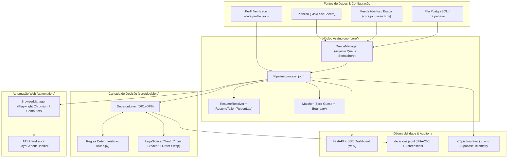

# Job Application Harness (`ia_candidata`)

<p align="left">
  <strong>🇧🇷 Português (PT-BR)</strong> &nbsp;|&nbsp; 🇺🇸 <a href="README.en.md"><strong>Read in English (README.en.md)</strong></a>
</p>

Harness assíncrono em **Python 3.11+** para **orquestração resiliente de navegadores, tomada de decisão estatística calibrada e automação de formulários web ancorada em fatos**, aplicado a fluxos de Application Tracking Systems (**Greenhouse, Lever, Workable, Indeed** e adaptadores compatíveis).

O projeto foi desenhado como um estudo prático de engenharia para resolver quatro problemas clássicos de agentes web em produção: **concorrência limitada e idempotência pós-envio**, **calibração de decisões híbridas (regras + ML)**, **prevenção contra alucinação e prompt injection**, e **observabilidade em tempo real**.

---

## 🧠 Destaques de Engenharia & Arquitetura

### 1. Motor de Decisão Híbrido & Calibração Estatística (`core/decision/`)
Em vez de delegar ramificações críticas a prompts abertos de LLM, o fluxo é decomposto em **6 Pontos de Decisão tipados (`DP1`–`DP6`)**:

| Ponto | Domínio | Tipo | Fallback Determinístico |
| :--- | :--- | :--- | :--- |
| **`DP1`** (`job_fit`) | Aderência técnica da vaga | `noul` (Sim/Não) | Score mínimo configurável (`MIN_FIT_SCORE`) |
| **`DP2`** (`resume_fallback`) | Seleção de currículo base | `choice` | Heurística de idioma + LLM estruturado |
| **`DP3`** (`blocker_check`) | Detecção de CAPTCHA / login / 404 | `noul` (Sim/Não) | Regex determinístico em `page_signals` |
| **`DP4`** (`question_sensitivity`) | Isolamento de dados protegidos (EEO/LGPD) | `noul` (Sim/Não) | Padrões em `_SENSITIVE_PATTERNS` |
| **`DP5`** (`field_mapping`) | Mapeamento semântico de campos | `choice` | Dicionário normalizado + sinônimos |
| **`DP6`** (`ready_to_submit`) | Prontidão final pré-envio | `noul` (Sim/Não) | Validação de campos `required` no DOM |

- **Sidecar Neural Isolado (`core/decision/laya_client.py`)**: Comunicação HTTP via `httpx` com *preflight* (`/plan`), ajuste automático de timeout em fallback para CPU, **mitigação de viés posicional via *order-swap*** em escolhas múltiplas e **Circuit Breaker half-open** (`LAYA_MAX_FAILURES`, `LAYA_BREAKER_COOLDOWN_S`).
- **Portão Estatístico de Calibração (ECE)**: O script [`scripts/eval_decisions.py`](scripts/eval_decisions.py) calcula *Expected Calibration Error (ECE)*, *selective accuracy* e cobertura em [`data/decision_goldens.json`](data/decision_goldens.json). Relatórios ausentes ou vencidos (`LAYA_EVAL_MAX_AGE_DAYS=14`) rebaixam automaticamente DPs liberadores para modo `shadow`.

### 2. Invariantes de Segurança, Idempotência e Anti-Alucinação
- **Assimetria de Segurança**: Modelos probabilísticos em `DP3`, `DP4` e `DP6` **nunca** podem revogar um bloqueio imposto por regra determinística.
- **Política *Zero-Guess* (`core/matcher.py`, `core/resume_tailor.py`)**: Perguntas obrigatórias sem fato verificável em `data/profile.json` retornam `null` e pausam o item em `NEEDS_REVIEW` em vez de fabricar respostas.
- **Defesa contra *Prompt Injection* & Isolamento de PII**: Descrições externas são encapsuladas em delimitadores `<job>` tratados como dados não confiáveis; perguntas sensíveis (EEO/LGPD) jamais são enviadas a APIs externas; o log de auditoria (`artifacts/decisions.jsonl`) grava apenas o digest `state_sha256`.
- **Idempotência Pós-Submissão (`core/queue_manager.py`)**: Falhas transitórias pré-envio usam *backoff* exponencial com respeito a `Retry-After`, mas qualquer exceção após o clique de envio dispara `PostSubmitError` e bloqueia retentativas.
- **Simulação Segura por Padrão (`DRY_RUN=true`)**: Preenche o formulário completo e captura evidência visual sem submeter até que `--no-dry-run` seja passado explicitamente.

### 3. Orquestração Assíncrona, Fila Transacional & Proxy de Cota Atômica
- **Pipeline Limitado (`core/pipeline.py`, `core/queue_manager.py`)**: `asyncio.Queue` + `Semaphore(MAX_CONCURRENCY)`, timeout por tarefa (`TASK_TIMEOUT_S`), gerenciamento de recursos com `AsyncExitStack` e captura graciosa de `CancelledError` preservando resultados parciais.
- **Cloud Worker & Edge Proxy (`cloud_worker.py`, `supabase/`)**: Daemon containerizado ([`Dockerfile`](Dockerfile), [`docker-compose.yml`](docker-compose.yml), [`deploy_vps.sh`](deploy_vps.sh)) com reivindicação concorrente de tarefas via PostgreSQL `FOR UPDATE SKIP LOCKED`, além de Edge Function [`supabase/functions/llm-proxy/index.ts`](supabase/functions/llm-proxy/index.ts) e migration SQL [`0006_llm_proxy_budget_quota.sql`](supabase/migrations/0006_llm_proxy_budget_quota.sql) para controle atômico de cota mensal.

### 4. Adaptadores Polimórficos, Navegador Semântico & Observabilidade SSE
- **Registry de Handlers (`automation/registry.py`)**: Implementação sobre `BaseATSHandler` para múltiplos formatos de formulário, interceptação de rotas Playwright para bloqueio de rastreadores e navegador semântico genérico ([`automation/laya_navigator.py`](automation/laya_navigator.py)) com sandbox interno ([`automation/laya_demo.py`](automation/laya_demo.py)).
- **Painel Web Local (`web/`)**: FastAPI + Server-Sent Events (`/api/events`) com streaming de etapas e telemetria ao vivo, mascaramento de segredos em `/api/config`, proteção contra *path traversal*, CORS restrito a `localhost` e compilação de currículos em PDF ATS-friendly via **ReportLab** ([`core/resume_pdf.py`](core/resume_pdf.py)).

---

## 🏗️ Topologia do Sistema



---

## 📁 Estrutura do Repositório

```text
ia_candidata/
├── main.py                  # CLI principal (planilha local/Sheets, busca ao vivo ou Supabase)
├── cloud_worker.py          # Worker daemon assíncrono com polling transacional no Supabase
├── automation/              # BrowserManager (Chromium/Camoufox), handlers ATS e LayaGenericHandler
├── core/                    # Pipeline, QueueManager, Matcher, ResumeTailor/PDF e motor DP1–DP6
├── config/                  # Settings tipados via Pydantic Settings (.env)
├── storage/                 # Clientes Google Sheets/Drive (imutabilidade da origem) e Supabase
├── supabase/                # Migration SQL de cota atômica e Edge Function llm-proxy
├── web/                     # Painel FastAPI + SSE + SPA estática + mascaramento de segredos
├── scripts/                 # Utilitários OAuth, sessão persistente, eval_decisions.py (ECE) e agendamento
├── data/                    # Profile de exemplo (profile.example.json) e dataset golden (decision_goldens.json)
├── docs/                    # Documentação técnica, ADRs e contratos (docs/okf/)
└── tests/                   # Testes unitários (220+ offline) e integração (aiohttp mock ATS + Playwright)
```

---

## 🚀 Instalação & Execução Local

### Pré-requisitos
- **Python 3.11+**
- **Git**

### Setup

```bash
# 1. Clonar e criar ambiente virtual
git clone https://github.com/Rauan2014/job-application-harness.git
cd job-application-harness
python -m venv .venv

# Windows (PowerShell):
.\.venv\Scripts\Activate.ps1
# Linux / macOS:
source .venv/bin/activate

# 2. Instalar dependências (produção e desenvolvimento)
pip install -r requirements.txt
pip install -r requirements-dev.txt

# Opcional — sidecar neural Laya:
pip install -r requirements-laya.txt

# 3. Instalar binários do Playwright (e Camoufox opcional)
playwright install chromium
python -m camoufox fetch

# 4. Configurar ambiente e perfil de exemplo
cp .env.example .env
cp data/profile.example.json data/profile.json
```

> **Dica de execução offline:** Para rodar localmente sem Google Drive, defina `DRIVE_FOLDER_ID=none` no `.env` e coloque PDFs em `cache/resumes/`. Para operar 100% determinístico sem chamadas a LLM, utilize `--backend rules --no-llm`.

---

## 🖥️ Modos de Operação

### 1. Painel Visual & Telemetria em Tempo Real (`web/`)
```bash
python -m web
# Windows: iniciar_painel.bat | Linux/macOS: ./iniciar_painel.sh
```
Acesse `http://127.0.0.1:8000` para inspecionar o stream SSE (`/api/events`), testar o **Sandbox Semântico do Laya Web Navigator** sem chamadas externas, editar configurações com mascaramento de chaves e visualizar capturas de tela e consumo de tokens.

### 2. Interface de Linha de Comando (`main.py`)
```bash
# Simulação segura em dry-run (padrão: preenche e captura screenshot sem submeter)
python main.py --sheet tests/fixtures/vagas_sample.csv --limit 3

# Modo 100% determinístico offline (sem chamadas externas a LLM ou sidecar)
python main.py --sheet tests/fixtures/vagas_sample.csv --limit 3 --backend rules --no-llm

# Busca em feeds abertos + simulação em dry-run
python main.py --search "Python Backend" --limit 5

# Pausar estritamente em NEEDS_REVIEW se faltar qualquer dado obrigatório no perfil
python main.py --limit 3 --no-autonomous

# Submissão real nos portais ATS (desativa dry-run explicitamente)
python main.py --limit 3 --no-dry-run

# Consumir fila pendente do Supabase
python main.py --from-supabase --limit 10
```

<details>
<summary>Referência completa de flags CLI e schema de planilhas</summary>

| Flag | Descrição | Padrão |
| :--- | :--- | :--- |
| `--sheet PATH_OR_URL` | Caminho local (`.xlsx`/`.csv`) ou URL/ID do Google Sheets | `GOOGLE_SHEET_URL` ou `data/vagas.xlsx` |
| `--search QUERY` | Busca em feeds configurados e enfileira resultados | Desativado |
| `--from-supabase` | Consome vagas pendentes da tabela `job_applications` | `False` |
| `--profile PATH` | Caminho do JSON de perfil do candidato | `data/profile.json` |
| `--limit N` | Limite máximo de vagas nesta execução | Sem limite |
| `--dry-run` / `--no-dry-run` | Simulação segura vs. envio oficial no ATS | `--dry-run` (`True`) |
| `--concurrency N` | Limite de navegadores simultâneos | `MAX_CONCURRENCY` (`3`) |
| `--backend {laya,rules}` | Motor de decisão (`laya` ou regras determinísticas) | `DECISION_BACKEND` (`laya`) |
| `--browser {camoufox,chromium}` | Motor de navegador | `USE_CAMOUFOX` (`camoufox`) |
| `--no-llm` | Desativa chamadas externas a LLM | `False` |
| `--autonomous` / `--no-autonomous` | Síntese de campos opcionais vs. revisão humana estrita | `AUTONOMOUS_MODE` |
| `--sync-drive` | Sincroniza currículos do Google Drive antes de iniciar | `False` |

</details>

### 3. Sincronização de Feeds & Worker Containerizado
```bash
# Sincronização pontual ou agendada de feeds abertos (core/daily_job_hunter.py)
python -m core.daily_job_hunter --run-now

# Worker em Docker (utiliza .env.worker.example como template)
cp .env.worker.example .env
docker compose up -d --build
```

---

## 🧪 Testes, Qualidade Estática & Avaliação Estatística

Toda a suíte unitária roda **100% offline** (com `respx` para mocks HTTP e fixtures isoladas), enquanto a suíte de integração sobe servidores `aiohttp` locais para validar fluxos completos no Playwright sem dependência de rede externa:

```bash
# Testes unitários rápidos (offline)
pytest tests/unit -q

# Testes de integração (servidores mock aiohttp + Playwright)
pytest tests/integration -m "integration and not laya_live" -q

# Lint (Ruff) e checagem estática de tipos (Mypy)
ruff check .
mypy core config automation storage web main.py cloud_worker.py

# Avaliação estatística de calibração (ECE, selective accuracy e cobertura)
python scripts/eval_decisions.py
```

---

## 📚 Documentação Técnica (`docs/okf/`)

- [Índice do Grafo de Conhecimento](docs/okf/index.md)
- [Arquitetura & Pipeline Assíncrono](docs/okf/architecture.md)
- [Motor de Decisão Calibrada (DP1–DP6 & ECE)](docs/okf/decision_engine.md)
- [Segurança, Ética & Privacidade](docs/okf/security_and_ethics.md)
- [Contratos de Dados (Pydantic v2)](docs/okf/data_contract.md)
- [Especificação da Interface Web](docs/okf/ui_specification.md)
- [Log de Decisões Arquiteturais (ADRs)](docs/okf/log.md)
- [Especificação Consolidada](docs/OKF_SPECIFICATION.md)

---

## ⚠️ Aviso Legal e Uso Responsável

Este software foi desenvolvido para **pesquisa em engenharia de agentes web, avaliação estatística de decisões e produtividade pessoal**. Quem executa a ferramenta é responsável por manter a veracidade integral dos dados em `data/profile.json`, respeitar os Termos de Serviço das plataformas integradas e auditar execuções em modo `--dry-run`.

## 📄 Licença

Distribuído sob a **Sustainable Use License (SUL 1.0)** — modelo *Fair-Code*. Consulte [`LICENSE`](LICENSE) para os termos completos.
