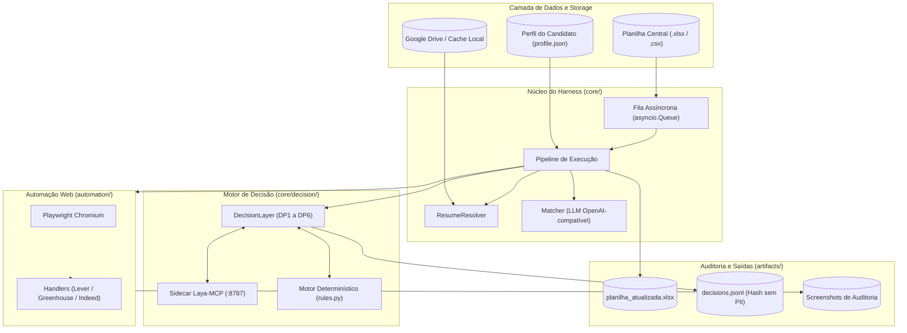

# Candidata IA — Especificação Técnica Consolidada (Modelo OKF)

> **Padrão Normativo**: Open Knowledge Format (Google Cloud, v0.2)  
> **Status**: Pronto para Avaliação e Auditoria de Abertura Open Source  
> **Módulos do Grafo OKF**: [docs/okf/index.md](okf/index.md)

---

## 1. Visão Executiva e Propósito

O **Candidata IA** (`job-harness`) é uma solução de software em Python 3.11+ projetada para automação de candidaturas em plataformas de vagas (Lever, Greenhouse e agregadores compatíveis como Indeed).

Diferente de scripts automatizados convencionais, o sistema implementa **engenharia defensiva e governança ética**:
1. **Triagem Calibrada**: Avaliação de compatibilidade e tomada de decisão via modelo estatístico calibrado (sidecar Laya) com medição de erro de calibração esperada (ECE) e fallback determinístico por regras.
2. **Resolução Determinística de Currículos**: Seleção automática da versão de currículo mais adequada utilizando distância léxica (`difflib`) e normalização semântica.
3. **Preenchimento Restrito aos Fatos**: Assistência por LLMs compatíveis com OpenAI estritamente ancorada nos dados declarados pelo candidato em `data/profile.json` (política *Zero-Guess* / proibição de alucinação).
4. **Execução Segura por Padrão**: Modo de simulação (`DRY_RUN=True`) ativo por padrão, sem submissão acidental.

---

## 2. Topologia da Arquitetura

---

## 3. Os 6 Pontos de Decisão (Decision Points DP1 a DP6)

A lógica do sistema não recorre a prompts livres para bifurcações operacionais. Ela é dividida em 6 pontos de decisão formalmente tipados:

| Ponto | Nome Interno | Pergunta | Método Padrão | Comportamento no Fallback |
| :--- | :--- | :--- | :--- | :--- |
| **DP1** | `job_fit` | "O perfil é compatível com esta vaga?" | Laya (`noul`) | Filtro por nota mínima (`MIN_FIT_SCORE >= 70`). |
| **DP2** | `resume_fallback` | "Qual currículo é mais adequado?" | Laya (`choice`) | Detecção de idioma (PT vs EN) + LLM estruturado. |
| **DP3** | `blocker_check` | "A página está bloqueada por CAPTCHA/login?" | Laya (`noul`) | Expressões regulares em `_BLOCKER_PATTERNS`. |
| **DP4** | `question_sensitivity` | "A pergunta trata de autodeclaração protegida (EEO)?" | Laya (`noul`) | Expressões regulares em `_SENSITIVE_PATTERNS`. |
| **DP5** | `field_mapping` | "A qual campo do perfil esta pergunta corresponde?" | Laya (`choice`) | Mapeamento por dicionário de sinônimos conhecidos. |
| **DP6** | `ready_to_submit` | "O formulário está validado para submissão?" | Laya (`noul`) | Verificação de campos `required` preenchidos. |

---

## 4. Invariantes de Segurança e Proteção de Dados

| Invariante | Definição e Garantia Técnica |
| :--- | :--- |
| **1. DRY_RUN Seguro** | `DRY_RUN=True` por padrão. Nenhuma submissão real é disparada sem o argumento `--no-dry-run`. |
| **2. Blindagem EEO** | Dados de autodeclaração (gênero, raça, deficiência, orientação sexual) **jamais são transmitidos a LLMs ou APIs externas**. São respondidos diretamente a partir de `profile.eeo`. |
| **3. Proibição de Alucinação** | Se um campo obrigatório não puder ser respondido com base estrita no `data/profile.json`, o valor é definido como `null` e a vaga vai para `NEEDS_REVIEW`. |
| **4. Sem Retentativa Pós-Submit** | Qualquer exceção levantada após o clique no botão de envio (`PostSubmitError`) aborta a execução sem retentativa, prevenindo envios duplicados. |
| **5. Anonimização em Logs** | O arquivo `artifacts/decisions.jsonl` armazena exclusivamente `state_sha256`, eliminando qualquer risco de persistência de PII. |

---

## 5. Auditoria Prévia de Abertura Open Source

### 🔴 Bloqueadores de Segurança Identificados
1. **Chave Real no `.env.example` (Linha 4)**: `LLM_API_KEY=AQ.Ab8RN6...` deve ser substituída por `LLM_API_KEY=sua_chave_aqui`.
2. **Arquivos de Credenciais na Raiz**: `client_secret.json` e `token.json` devem ser mantidos estritamente fora do controle de versão via `.gitignore`.
3. **Dados Pessoais do Candidato**: `data/profile.json` contém dados reais e deve permanecer ignorado; apenas `data/profile.example.json` deve ser público.
4. **Histórico Real de Candidaturas**: Pasta `artifacts/` possui cópias reais de planilhas e logs anteriores; deve permanecer totalmente ignorada.
5. **Fallback com URL Pessoal**: Linha 262 de [core/pipeline.py](file:///c:/codes/ia_candidata/core/pipeline.py#L262) contém link pessoal de LinkedIn, devendo ser generalizado.

### 📜 Licença e Termos Legais Recomendados
- **Licença de Software**: Recomendada a **MIT License** ou **Apache 2.0** pela ampla receptividade da comunidade de código aberto.
- **Termo de Isenção de Responsabilidade (Disclaimer)**: Inclusão obrigatória de cláusula destacando que a ferramenta é destinada a uso educacional e produtividade pessoal, cabendo ao usuário a observância aos Termos de Serviço de cada plataforma (Greenhouse, Lever, etc.).

---

## 6. Documentos Conectados (Grafo OKF)

- [docs/okf/index.md](okf/index.md) — Índice do Grafo de Conhecimento
- [docs/okf/architecture.md](okf/architecture.md) — Especificação de Arquitetura e Fluxo
- [docs/okf/decision_engine.md](okf/decision_engine.md) — Teoria de Decisão e Calibração Laya
- [docs/okf/security_and_ethics.md](okf/security_and_ethics.md) — Políticas de Segurança e Ética
- [docs/okf/data_contract.md](okf/data_contract.md) — Modelos Pydantic e Esquemas de Dados
- [docs/okf/open_source_readiness.md](okf/open_source_readiness.md) — Plano e Governança Open Source
- [docs/okf/log.md](okf/log.md) — Log Canônico de Decisões e Mudanças
